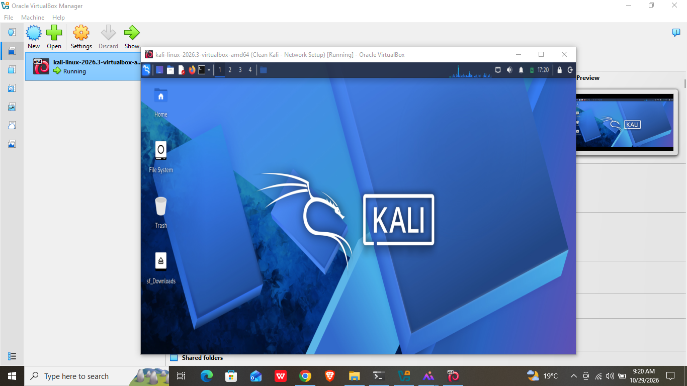
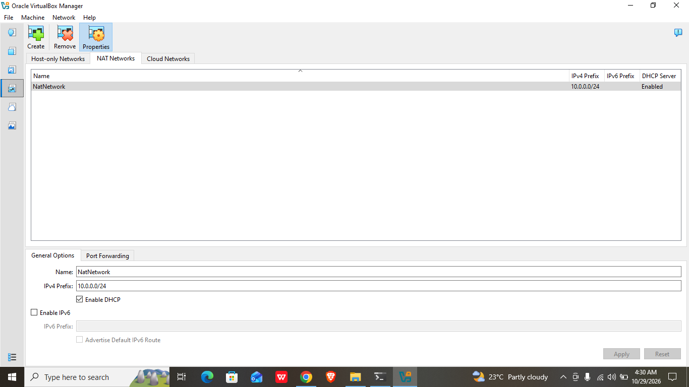
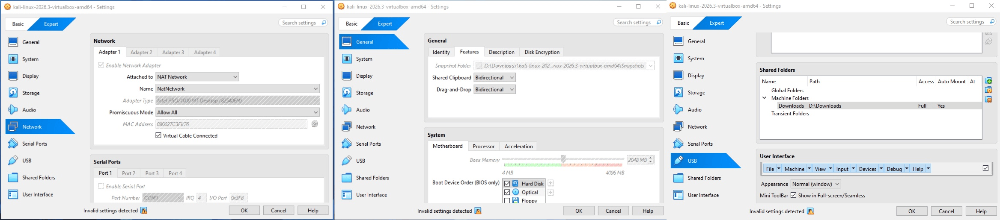
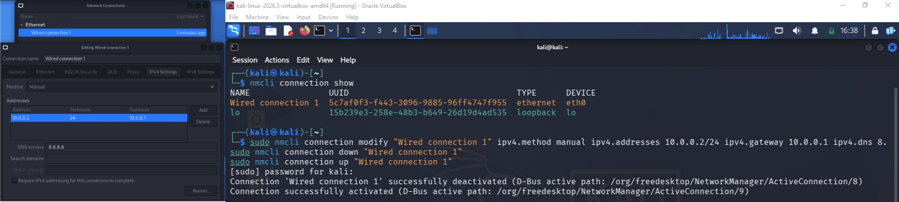
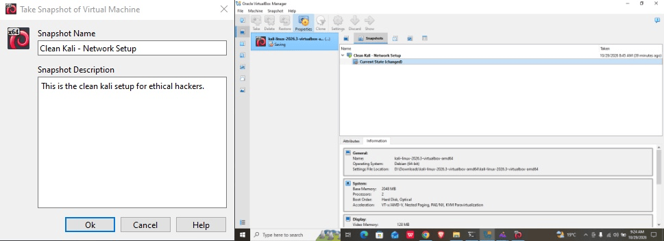
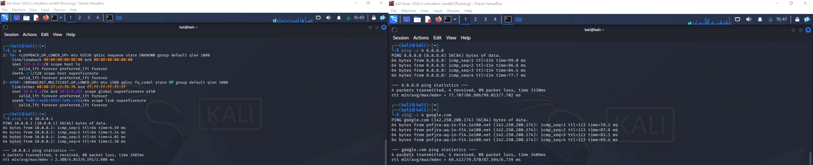

# 🔐 Cybersecurity Lab Setup: VirtualBox + Kali Linux

*A private virtual lab for ethical hacking and penetration-testing practice*



---

## 📌 Project Overview

This is my Week 1 project in the Networkwalks Cybersecurity Internship (Batch B084). I built an isolated virtual lab on my own PC using **VirtualBox** and **Kali Linux**.

All lab machines sit on a private NAT Network (`10.0.0.0/24`). Kali is the attacker machine, and target machines can be added to the same network later for authorized practice.

## 🎯 Objectives

- Install VirtualBox and import Kali Linux as a VM
- Create a custom NAT Network on `10.0.0.0/24`
- Give Kali a fixed IP of `10.0.0.2/24` with full Internet access
- Enable shared clipboard, drag and drop, and a shared Downloads folder
- Verify connectivity and take a clean snapshot
- Document the whole process

## ⚠️ Ethical Use

This lab is for learning only. I only test systems I own or the lab machines inside this network. I do not use these tools against anyone else's systems without written permission.

## 🏗️ Lab Architecture

```
Windows host (main OS)
└── VirtualBox
    └── NatNetwork  10.0.0.0/24  (gateway 10.0.0.1)
        └── Kali Linux  10.0.0.2/24   (attacker machine)
        └── Future target VMs: 10.0.0.3 – 10.0.0.99
```

## ⚙️ Lab Configuration

| Item | Value |
|---|---|
| Host OS | Windows 10 Pro 22H2 |
| Host RAM / CPU | 4 GB DDR3 / Intel Celeron 3215U @ 1.70 GHz |
| Hypervisor | VirtualBox 7.2.22 |
| Guest OS | Kali Linux 2026.3 |
| Kali RAM | about 2 GB (1968 MB shown by `free -m`) |
| Network type | NAT Network (`NatNetwork`), DHCP enabled |
| Network range | 10.0.0.0/24 |
| Kali IP | 10.0.0.2/24 |
| Gateway | 10.0.0.1 |
| DNS | 8.8.8.8 |
| Shared folder | Host `Downloads`, auto-mount on |
| Clipboard / Drag & Drop | Bidirectional |

## 🪜 Setup Steps

### Step 1: Install 7-Zip
Needed to extract the compressed Kali VM image.

### Step 2: Install VirtualBox
Downloaded the latest version from virtualbox.org and installed it on the host.

### Step 3: Create the NAT Network
`File → Tools → Network → NAT Networks → Create`, then set:
- Name: `NatNetwork`
- IPv4 prefix: `10.0.0.0/24`
- DHCP: enabled



### Step 4: Import Kali Linux
Downloaded the pre-built VirtualBox image from kali.org, extracted it, and imported it. In the VM settings:
- Network → Adapter 1 → attached to **NAT Network** → `NatNetwork`
- General → Advanced → Shared Clipboard and Drag'n'Drop = **Bidirectional**
- Shared Folders → added the host `Downloads` folder with auto-mount



### Step 5: Set the static IP in Kali
Network icon → Edit Connections → Wired connection 1 → IPv4 Settings:
- Method: Manual
- Address `10.0.0.2`, netmask `24`, gateway `10.0.0.1`
- DNS `8.8.8.8`



### Step 6: Take a snapshot
Created a snapshot named `Clean Kali - Network Setup` as a recovery point.



## 🔎 Verification

| Test | Command | Result |
|---|---|---|
| IP address | `ip a` | 10.0.0.2/24 shown |
| Gateway | `ping -c 4 10.0.0.1` | 4/4 replies, 0% packet loss (avg about 4 ms) |
| Internet | `ping -c 4 8.8.8.8` | 4/4 replies, 0% packet loss (avg about 87 ms) |
| DNS | `ping -c 4 google.com` | Name resolved, 4/4 replies, 0% packet loss |
| Shared folder | open the mounted Downloads folder | Host Downloads folder visible and accessible in Kali |
| Clipboard / drag & drop | copy text and a file between host and VM | Text copied and file dragged between Windows and Kali successfully |



## 🐞 Problems I Faced and How I Solved Them

**Problem 1: Static IP set in the GUI did not take effect**

I first set the IPv4 address in the network settings window (Edit Connections → Wired connection 1 → IPv4 Settings → Manual), but it did not work. Kali stayed on the address given by DHCP (`10.0.0.3`) instead of `10.0.0.2`.

I checked the connection name with `nmcli connection show`, then set everything from the terminal instead:

```bash
sudo nmcli connection modify "Wired connection 1" ipv4.method manual ipv4.addresses 10.0.0.2/24 ipv4.gateway 10.0.0.1 ipv4.dns 8.8.8.8 ipv4.dad-timeout 0
sudo nmcli connection down "Wired connection 1"
sudo nmcli connection up "Wired connection 1"
```

After this, `ip a` showed a static `10.0.0.2/24`, and the gateway, `8.8.8.8` and `google.com` all replied to ping.

**Tip for others:** if the GUI settings do not apply, use `nmcli`, and set `ipv4.dad-timeout 0` as well. Connection names can differ, so run `nmcli connection show` first.

## 💡 What I Learned

- **NAT vs NAT Network:** a NAT Network lets several VMs talk to each other and still reach the Internet, which is what a multi-machine lab needs.
- **Static addressing:** how the IP, netmask, gateway and DNS fit together, and how to test each one.
- **Snapshots:** a clean snapshot gives a safe point to return to before risky experiments.
- **Building a Kali environment:** I learned how to set up and configure a complete Kali Linux environment, which is the foundation I need to start in cybersecurity and to practice for my CEH (Certified Ethical Hacker) studies.
- **Troubleshooting and documentation:** when the GUI setting failed, I fixed it from the terminal. Writing down the exact commands and results makes the setup repeatable and helps others facing the same issue.

## 🔗 Tools & Resources

- 7-Zip: https://7-zip.org/download.html
- VirtualBox: https://virtualbox.org/wiki/Downloads
- Kali Linux: https://kali.org/get-kali

## 👤 Author

**Arban Iqbal Khan**, Cybersecurity Intern, Batch B084
GitHub: https://github.com/arbaniqbalk
LinkedIn: https://www.linkedin.com/in/arbaniqbalk/

## 📌 Project Information

Program: Cybersecurity Internship at Networkwalks | Week 01 | Project: Cybersecurity & Pentesting Lab Setup
